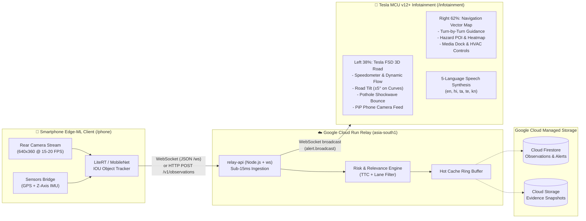

# MargAI – AI-Powered Connected Vehicle Road Safety & Tesla MCU v12 Cockpit

> **Google Startup Buildathon India 2026**  
> Edge-ML Smartphone Dashcam coupled to a Tesla MCU v12+ Split-Screen In-Car Infotainment Web App via Google Cloud Run WebSocket & REST Relay with Firestore & Cloud Storage.

---

## 1. System Architecture



---

## 2. Monorepo Structure

```text
margai-cloud-mvp/
├── packages/
│   └── contracts/              # Shared TypeScript interfaces & Zod validators
│       ├── package.json
│       ├── tsconfig.json
│       └── src/index.ts        # EventEnvelope, GeoEstimate, HazardType, RiskLevel, DriverAlert
├── services/
│   └── relay-api/              # Node.js + TypeScript + Express + ws (Cloud Run)
│       ├── src/
│       │   ├── server.ts       # HTTP REST (/v1/observations, /v1/hazards, /health) + WS (/ws)
│       │   ├── riskEngine.ts   # Deterministic road-relevance, lane-offset & TTC filter
│       │   └── store.ts        # In-memory hot cache + Firestore persistence adapter
│       ├── Dockerfile
│       └── package.json
├── apps/
│   └── cockpit-web/            # React + TypeScript + Vite (Serves both /phone & /infotainment)
│       ├── src/
│       │   ├── pages/
│       │   │   ├── PhoneNode.tsx        # Rear camera + LiteRT.js ML detector + GPS/IMU bridge
│       │   │   └── InfotainmentHUD.tsx  # Tesla MCU v12+ split-screen (38% FSD 3D road + 62% Nav Map)
│       │   ├── ml/
│       │   │   └── roadDetector.ts      # On-device LiteRT / MobileNet detector + IOU tracker
│       │   ├── audio/
│       │   │   └── alertAudio.ts        # Web Audio graduated chimes + 5-language SpeechSynthesis
│       │   ├── App.tsx
│       │   └── main.tsx
│       ├── Dockerfile
│       └── package.json
├── deploy.sh                   # One-command Google Cloud Build & Cloud Run deployment script
└── README.md
```

---

## 3. Tesla MCU v12+ Split-Screen Design Rationale

The In-Car Infotainment system matches the **Tesla Model 3 / Model Y MCU v12+ landscape architecture**:

1. **Left 38% – FSD 3D Perspective Road Visualization**:
   - **Speedometer**: Prominent tabular numerals with gear selector (`P R N D`).
   - **Speed Limit Sign**: European/Indian 50 km/h circular sign.
   - **Dynamic Road Flow**: Dashed lane line flow speed is formula-tied to vehicle speed:
     $$T_{\text{flow}} = \frac{17.5}{\max(V_{\text{mps}}, 0.5)}\text{ seconds}$$
   - **Curvature Horizon Tilt**: Tilts $\pm 5^\circ$ when turning into sharp curves.
   - **Pothole Shockwave Bounce**: Bounces the cockpit shell (`translateY(10px)`) when the smartphone IMU registers a bump ($Z > 1.8G$).
   - **Picture-in-Picture (PiP)**: Live rear camera feed streamed from the smartphone mounted on the windshield.
   - **Top Floating HUD Alert**: Displays distance countdown with multi-language voice replay.

2. **Right 62% – Navigation Vector Map & Controls**:
   - High-contrast dark vector map with real-time route path and rotating vehicle heading avatar.
   - Turn-by-turn navigation header ("Turn right in 280 m onto Outer Ring Road").
   - Hazard pins (potholes, cattle, accidents) dropped automatically from edge-ML detections.
   - Floating Spotify / Media Player dock.
   - Bottom HVAC climate control bar (Driver / Passenger temperatures, Seat heaters, Defrost, Fan).

---

## 4. Multi-Language Indian Localization

Audio warnings use UNECE graduated audio chimes plus Web SpeechSynthesis with native Indian accents:
- **English** (`en-IN`): *"Deep pothole ahead! Slow down immediately."*
- **Hindi** (`hi-IN`): *"आगे सड़क पर गड्ढा है। गति धीमी करें।"*
- **Tamil** (`ta-IN`): *"முன்னே சாலையில் குழி உள்ளது. வேகத்தைக் குறையுங்கள்."*
- **Telugu** (`te-IN`): *"ముందు గుంత ఉంది. వేగం తగ్గించండి."*
- **Kannada** (`kn-IN`): *"ಮುಂದೆ ರಸ್ತೆಯಲ್ಲಿ ಗುಂಡಿ ಇದೆ. ವೇಗ ಕಡಿಮೆ ಮಾಡಿ."*

---

## 5. Local Quickstart

### Prerequisites
- Node.js 18+ or 20+
- npm 9+

### Installation & Execution
```bash
cd margai-cloud-mvp

# 1. Install all dependencies across workspaces
npm install

# 2. Build the shared contracts package
npm run build -w packages/contracts

# 3. Start the Cloud Run Relay API (Port 8080)
npm run dev -w services/relay-api

# 4. In a separate terminal, start the Cockpit Web App (Port 5173)
npm run dev -w apps/cockpit-web
```

### URLs
- **Tesla MCU Infotainment HUD**: [http://localhost:5173/?mode=infotainment](http://localhost:5173/?mode=infotainment)
- **Smartphone Edge-ML Cam**: [http://localhost:5173/?mode=phone](http://localhost:5173/?mode=phone)
- **Cloud Run Relay Health Probe**: [http://localhost:8080/health](http://localhost:8080/health)

---

## 6. One-Command Google Cloud Run Deployment

Deploy directly to Google Cloud Run (Mumbai region `asia-south1`) with automatic Firestore & Cloud Storage provisioning:

```bash
# Authenticate with Google Cloud
gcloud auth login
gcloud config set project <YOUR_GCP_PROJECT_ID>

# Run deployment script
./deploy.sh
```

The script will automatically:
1. Enable `run.googleapis.com`, `cloudbuild.googleapis.com`, `firestore.googleapis.com`, and `storage.googleapis.com`.
2. Provision a Cloud Firestore database in Native mode.
3. Provision a Cloud Storage bucket for hazard evidence snapshots.
4. Build and deploy `margai-relay-api` with WebSocket support (`--session-affinity`, `--min-instances 1`).
5. Build and deploy `margai-cockpit-web` on Cloud Run.
