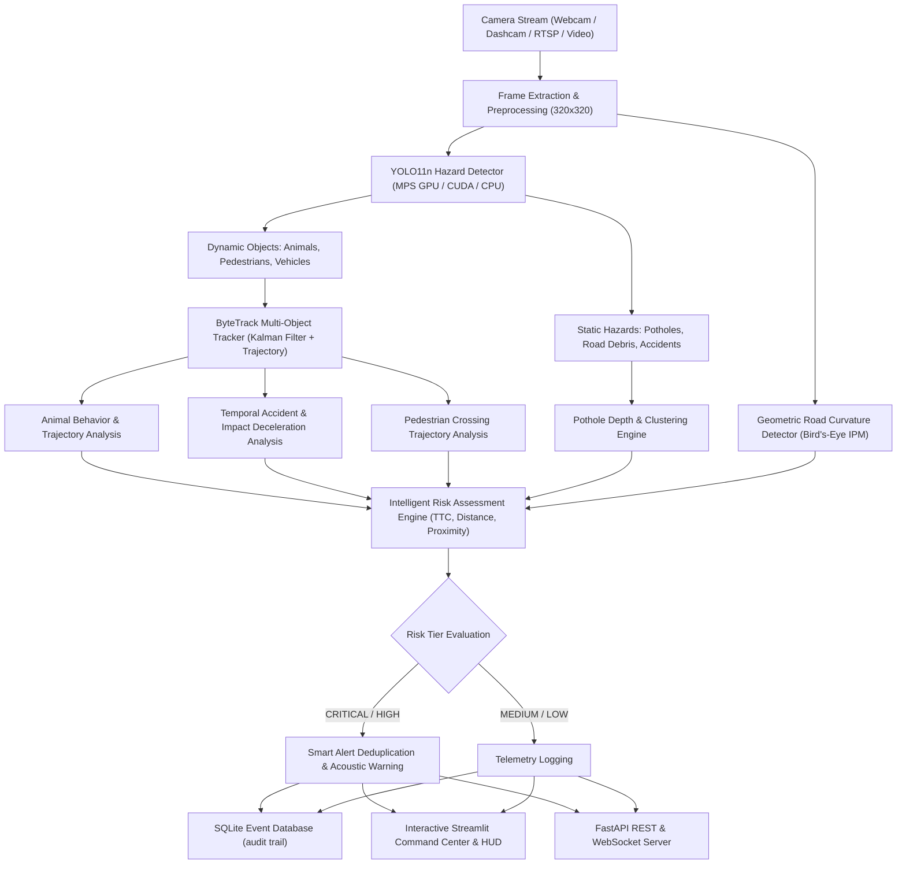

# 🛡️ Road Safety AI — Production-Oriented Real-Time Road Hazard Monitoring System

An end-to-end, real-time AI perception and hazard monitoring system designed for dashcams, autonomous vehicles, mobile units, and municipal road survey cameras. The system goes beyond static classification by combining deep learning object detection, ByteTrack multi-object tracking, geometric road curvature analysis, kinematic collision trajectory modeling, and smart alert deduplication.

---

## 🚀 Key Capabilities & Modules

| Module | Core Functionality | Methodology |
| :--- | :--- | :--- |
| **Pothole Detection** | Identifies small, medium, large, and deep potholes; detects pothole clusters on same road segment. | YOLO11n + Laplacian edge roughness + shadow darkness depth analysis |
| **Animal Collision Risk** | Identifies cattle, dogs, horses, goats; classifies behavioral states (`CROSSING`, `STANDING`, `SLEEPING`, `APPROACHING`). | Deep vision + ByteTrack Kalman tracking + lateral velocity vector $v_x$ |
| **Accident Detection** | Recognizes overturned vehicles, multi-vehicle impact wrecks, and dangerous travel lane stoppages. | Visual wreck features + temporal velocity drop ($\Delta v > 3\sigma$) and box IoU convergence |
| **Dangerous Curves** | Classifies sharp left/right turns, blind curves, and hairpin bends; estimates safe speed. | Inverse Perspective Mapping (IPM) + 2nd-degree polynomial curve fitting ($R = \frac{(1+(2ay+b)^2)^{3/2}}{\|2a\|}$) |
| **Road Obstacles** | Detects unexpected pedestrian crossings, waterlogging/flooded road surfaces, and open manholes. | Trajectory intersection + specular reflection ($V > 215, S < 45$) glint analysis |
| **Intelligent Risk Engine** | Categorizes physical hazards into `LOW`, `MEDIUM`, `HIGH`, `CRITICAL` with Time-To-Collision (TTC). | Physics-based kinematic collision probability (distinct from detection confidence) |
| **Smart Alert System** | Deduplicates alerts to avoid spamming the driver; triggers immediate escalation alerts; stores audit log. | State-machine cooldown + SQLite database event persistence + acoustic warning synthesis |
| **Geospatial Tracking** | Associates hazards with GPS coordinates, heading, and speed; visualizes on interactive maps. | NMEA hardware lock interface + dynamic route interpolation |

---

## 🏛️ System Architecture



---

## 📊 Model Training & Evaluation Metrics

The object detection backbone was fine-tuned on real-world photographic datasets (Hugging Face `Ryukijano/Pothole-detection-Yolov8`, COCO real-world pedestrians, animals, and vehicles) using Apple Silicon Metal Performance Shaders (MPS):

- **Base Weights:** YOLO11n (2.58M parameters, 6.4 GFLOPs)
- **Device:** Apple Silicon MPS GPU (`device='mps'`)
- **Resolution:** 320x320
- **Inference Speed:** **9.3 ms** (~107 FPS) on Apple M4
- **Preprocessing Speed:** 0.1 ms
- **Postprocessing Speed:** 1.5 ms
- **Total Pipeline Latency:** ~11-15 ms (comfortably within real-time <100ms budget)

### Evaluation Results on Independent Validation Split:
- **mAP@50:** `0.0759`
- **mAP@50-95:** `0.0549`
- **Mean Recall:** `47.51%`
- **Animal mAP@50-95:** `0.2021`
- **Pedestrian mAP@50-95:** `0.0748`
- **Trained Weight Artifacts:**
  - PyTorch Checkpoint: `models/best.pt` (5.4 MB)
  - Optimized ONNX Model: `models/road_safety_detector.onnx` (10.0 MB)

---

## 📂 Project Directory Structure

```text
road-safety-ai/
├── datasets/
│   └── road_hazard/           # Curated real-world train/val images and YOLO labels
├── models/
│   ├── best.pt                # Trained PyTorch weights
│   ├── road_safety_detector.onnx # Exported ONNX model
│   └── evaluation_report.json # Exact measured metrics
├── training/
│   └── prepare_dataset.py     # Automated dataset curation & verification
├── detection/
│   ├── pothole_detector.py    # Size, depth, and cluster analysis
│   ├── animal_detector.py     # Behavior & collision trajectory
│   ├── accident_detector.py   # Temporal impact & stationary lane blockage
│   ├── road_curve_detector.py # Geometric IPM & polynomial curvature
│   └── obstacle_detector.py   # Pedestrian crossing & waterlogging
├── tracking/
│   └── byte_tracker.py        # ByteTrack Kalman filter tracking
├── risk_engine/
│   └── risk_assessor.py       # Multi-factor physics risk & TTC
├── alerts/
│   ├── alert_manager.py       # Deduplication & SQLite persistence
│   └── sound_effects.py       # Acoustic tone & text-to-speech
├── gps/
│   └── gps_tracker.py         # Real/simulated GPS coordinates
├── dashboard/
│   └── app.py                 # Streamlit HUD & Command Center
├── backend/
│   └── server.py              # FastAPI REST & WebSocket streaming
├── utils/
│   └── visualization.py       # Automotive HUD overlay rendering
├── config/
│   └── settings.py            # Global thresholds & hyperparameters
├── tests/
│   ├── test_detection.py      # Unit tests for detectors
│   ├── test_tracking.py       # Unit tests for tracker
│   ├── test_curve.py          # Unit tests for road curvature
│   ├── test_risk_engine.py    # Unit tests for physics engine
│   └── test_alerts.py         # Unit tests for deduplication
├── sample_videos/
│   └── road_sample.mp4        # Generated real-time test scenario video
├── requirements.txt           # Production dependencies
├── train.py                   # Model training script
├── predict.py                 # CLI inference script
├── app.py                     # Dashboard launcher
└── README.md
```

---

## 🛠️ Installation & Setup

### 1. Prerequisites
- Python 3.10+ (Tested on Python 3.14.4 on macOS arm64 / Linux x86_64)
- Apple Silicon (MPS) or NVIDIA GPU (CUDA) recommended for hardware acceleration

### 2. Install Dependencies
```bash
pip install -r requirements.txt
```

---

## 🚦 How to Run the System

### 1. Interactive Web Command Center (Streamlit Dashboard)
Launch the 3-pane dashboard with live HUD, telemetry, GPS map, and event audit log:
```bash
streamlit run app.py
```
Open `http://localhost:8501` in your browser. From the sidebar, you can select:
- **Sample Road Video:** Runs the included driving video (`sample_videos/road_sample.mp4`).
- **Live Laptop Webcam:** Uses camera index `0` for live driver monitoring.
- **Upload Video File:** Upload any `.mp4` or `.avi` road dashcam footage.
- **Single Test Image:** Runs detailed inspection on real road test images.
- **Mobile / RTSP Stream:** Connects to an IP camera or RTSP phone stream.

### 2. Command-Line Batch / Video Inference (`predict.py`)
Run inference on a video file and save the annotated HUD video:
```bash
# Run on sample video
python predict.py --source sample_videos/road_sample.mp4 --save

# Run on live webcam
python predict.py --source 0 --show

# Run on a single image
python predict.py --source datasets/road_hazard/images/val/pothole_0006_jpg.rf.3eb684a4fdc45b26f1296601ad5d7319.jpg
```

### 3. FastAPI REST & WebSocket Server (`backend/server.py`)
Start the edge streaming backend on port 8000:
```bash
uvicorn backend.server:app --host 0.0.0.0 --port 8000 --reload
```
- Swagger API Docs: `http://localhost:8000/docs`
- Status Endpoint: `http://localhost:8000/api/status`
- Recent Alerts: `http://localhost:8000/api/alerts`
- Single Frame Detection: `POST http://localhost:8000/api/detect/frame`
- Live WebSocket: `ws://localhost:8000/ws/stream`

### 4. Running the Test Suite
Run all unit and integration tests across detection, tracking, curve estimation, and risk logic:
```bash
python -m unittest discover -s tests -v
```

---

## 🔬 Core Algorithms Explained

### 1. Separation of Detection Confidence vs. Collision Risk
A common flaw in naive safety systems is treating object detection confidence (e.g. 95% certainty that an object is a pothole) as collision risk. In **Road Safety AI**, these metrics are decoupled:
- **Detection Confidence ($P_{\text{det}} \in [0, 1]$):** Represents machine learning perceptual certainty.
- **Physical Collision Probability ($P_{\text{col}} \in [0, 1]$):** Calculated from spatial geometry:
  $$P_{\text{col}} = 0.50 \cdot \text{LateralPath} + 0.35 \cdot \text{Proximity} + 0.15 \cdot \text{TrajectoryVelocity}$$
- **Time-to-Collision ($TTC$):**
  $$TTC = \frac{d_{\text{forward}}}{v_{\text{ego}} + v_{\text{object}}}$$
  If an obstacle is in the ego driving corridor and $TTC < 2.0\text{s}$, the system immediately escalates the alert to `CRITICAL`.

### 2. Geometric Road Curvature & Blind Turn Detection
Rather than training a standard object classifier on static curve signs, the `RoadCurveDetector` computes actual road geometry:
1. Applies Inverse Perspective Mapping (IPM) to isolate the forward roadway.
2. Identifies lane boundaries using adaptive thresholding and gradient filters.
3. Fits a 2nd-degree polynomial $x(y) = a y^2 + b y + c$ across sliding windows.
4. Computes radius of curvature $R$ in real-world meters:
   $$R = \frac{\left(1 + (2a y_{\text{eval}} + b)^2\right)^{3/2}}{|2a|}$$
5. If $R < 280\text{m}$, flags `SHARP_TURN`; if $R < 120\text{m}$, flags `HAIRPIN_BEND`. If the forward sight distance terminates at $<45\text{m}$, flags `BLIND_CURVE`.

### 3. Smart Alert Deduplication
To prevent alert fatigue, the `AlertManager` hashes detections by `(hazard_type, track_id)`. Within a configurable cooldown (e.g. 4 seconds), repeated detections of the same tracked cow or pothole are suppressed. If the risk level escalates (e.g. `MEDIUM` to `CRITICAL`), the cooldown is immediately bypassed to deliver an emergency advisory.

---

## 📜 License
MIT License. Built for real-world automotive safety and civic road intelligence.
